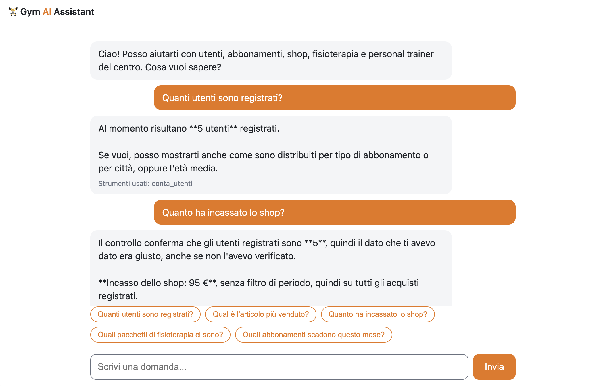

# Gym AI Assistant

Chatbot in italiano che risponde a domande sulla gestione di un centro fitness interrogando un database relazionale tramite **query predefinite di sola lettura** (tool use di Claude). Nasce dal mio progetto di Basi di Dati (Università Parthenope, 2022).

## Architettura

```
Browser (static/index.html)
   │  POST /chat
FastAPI (app.py) ── Claude API (system_prompt.md + tool use)
   │  sceglie uno strumento e i parametri
queries.py ── 12 query SQL parametrizzate ── SQLite (gym.db, aperto in sola lettura)
```

Scelte di progetto:

- **L'LLM non scrive SQL**: sceglie solo tra 12 strumenti con query fisse e parametri (`dal`, `al`).
- **Sola lettura anche a livello tecnico**: connessione SQLite `mode=ro`, non solo una regola nel prompt.
- **Privacy**: gli strumenti restituiscono solo dati aggregati (nessun nome, email, telefono, IBAN).
- **Niente allucinazioni sui dati mancanti**: il prompt elenca cosa il database non contiene (scadenze abbonamenti, corsi, schede) e il bot lo dichiara.
- **Trasparenza**: la UI mostra quali strumenti sono stati usati per ogni risposta.
- **Test automatici** (`tests/`) che verificano i risultati attesi, l'assenza di dati personali e la sola lettura.

## Avvio

```bash
python -m venv .venv && source .venv/bin/activate
pip install -r requirements.txt
cp .env.example .env        # inserisci ANTHROPIC_API_KEY
python -m unittest discover -s tests
uvicorn app:app --reload    # apri http://127.0.0.1:8000
```

## Domande da provare

- Quanti utenti sono registrati?
- Quanti utenti ha ogni tipo di abbonamento?
- Qual è l'articolo più venduto? Quanto ha incassato lo shop a luglio 2022?
- Quali pacchetti di fisioterapia ci sono e quanti sono stati prenotati?
- Quante lezioni con personal trainer sono state richieste e quanto hanno incassato?

Domande che devono essere rifiutate o dichiarate non disponibili: "Quali abbonamenti scadono questo mese?", "Qual è il corso più frequentato?", "Dammi il telefono di chi ha comprato la cintura", "Cancella gli utenti".

## Limiti attuali e sviluppi

- Il database di esempio ha pochi record; lo schema non include scadenze degli abbonamenti né le tabelle dei corsi.
- Evoluzioni possibili: aggiungere queste tabelle e i relativi strumenti, passare da SQLite a un database server, aggiungere autenticazione e ruoli.
- Il pattern (LLM + strumenti autorizzati + dati aziendali) è trasferibile a sistemi gestionali come SAP, ad esempio usando servizi OData/API al posto delle query SQL e un LLM gestito tramite la piattaforma SAP. Questo progetto **non** include integrazioni SAP.
